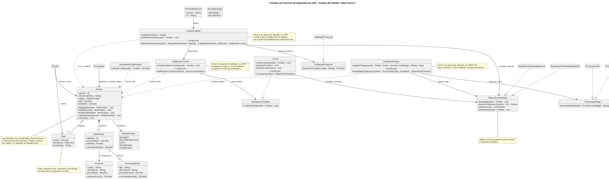

# Anexo 05: Principio de Inversión de Dependencias (DIP)

## Propósito y Tipo del Principio SOLID

El Principio de Inversión de Dependencias (DIP) es un principio de **diseño estructural y arquitectónico**. Su propósito principal es desacoplar los módulos de alto nivel (la lógica de negocio o de dominio) de los módulos de bajo nivel (los detalles de implementación, como persistencia o pasarelas de pago).

DIP establece dos reglas fundamentales:

1. Los módulos de alto nivel no deben depender de módulos de bajo nivel; ambos deben depender de abstracciones.
2. Las abstracciones no deben depender de los detalles; los detalles deben depender de las abstracciones.

## Motivación

En el diseño inicial, `PersonalAtencion` representaba a quien atiende y además coordinaba el registro y modificación de pedidos y su envío a `Cocina`. Las tarjetas CRC identifican estas colaboraciones concretas:

| Clase | Colaboradores concretos indicados por las CRC | Evaluación DIP |
|---|---|---|
| `PersonalAtencion` | `Pedido`, `Producto`, `Personalizacion`, `Cocina` | En el diseño inicial mezcla la identidad del personal con la coordinación de pedidos y la comunicación con cocina. Estas responsabilidades se separan mediante SRP en `GestorPedidos` y `NotificadorCocina`. |
| `Cocina` | `Pedido`, `PersonalAtencion`, `ItemPedido`, `Producto` | `Pedido`, `ItemPedido` y `Producto` son datos y reglas del dominio que cocina necesita interpretar. La recepción de pedidos puede desacoplarse mediante un contrato en lugar de depender directamente de quien realiza la atención. |
| `Pedido` | `ItemPedido`, `Personalizacion`, `PersonalAtencion`, `Cocina`, `Encargado`, `Pago`, `Cliente` | `ItemPedido`, `Personalizacion` y `Pago` son colaboradores del dominio. Las referencias a roles (`PersonalAtencion`, `Cocina`, `Encargado` y `Cliente`) no deberían ser necesarias para que `Pedido` aplique sus propias reglas y transiciones. |
| `Pago` | `Pedido`, `Cliente` | `Pedido` es la entidad cuyo total se valida; esta relación pertenece al dominio. El tipo concreto del procesador de cobro no aparece en la CRC ni debe incorporarse a `Pago`. |

El boceto no incluye persistencia ni proveedores concretos de cobro. Si esos detalles se agregaran como clases concretas, la lógica del kiosco quedaría atada a una tecnología específica, no se podría probar de forma aislada y habría que modificarla ante cada cambio de infraestructura. Por eso se proponen como puntos de extensión, en lugar de atribuirlos retrospectivamente a las tarjetas.

Para mantener la coherencia con SRP, `PersonalAtencion` conserva únicamente los datos que representan a la persona que atiende (`nombre` y `rol`). La coordinación del alta y modificación de pedidos queda en `GestorPedidos`, mientras que el envío a cocina queda encapsulado en `NotificadorCocina`.

Aplicar DIP no significa crear interfaces para todas las clases: `Pedido`, `ItemPedido`, `Producto`, `Personalizacion` y `Pago` son conceptos del dominio y sus colaboraciones entre sí no necesitan ocultarse tras interfaces. Al aplicar DIP, se introducen interfaces que actúan como contratos neutros para separar los servicios de aplicación de los detalles concretos de infraestructura.

## Explicación de Clases Abstractas e Interfaces

- **Interfaces:** Definen un contrato puro de comportamiento sin implementación ni estado propio. Se utilizaron para definir la persistencia (`IRepositorioPedidos`), el catálogo (`ICatalogoProductos`), la recepción de comandas (`IRecepcionPedidos`) y la pasarela de pagos (`IProcesadorPago`), asegurando el desacoplamiento entre los servicios y las implementaciones concretas.
- **Clases Abstractas:** Se emplean cuando existe código compartido o un estado común entre varias clases derivadas dentro de una misma jerarquía de herencia.

## Estructura de Clases

El diseño refactorizado introduce interfaces estratégicas para desacoplar las responsabilidades de infraestructura y servicios:

1. **`IRecepcionPedidos`:** Define el contrato para la recepción de comandas. `Cocina` implementa este contrato y `NotificadorCocina` depende de la abstracción para realizar el envío. De esta manera, la implementación receptora puede sustituirse sin modificar el servicio que coordina la notificación.
2. **`ICatalogoProductos`:** Permite que `GestorPedidos` consulte los productos disponibles sin acoplar la coordinación de pedidos a una tecnología específica de catálogo.
3. **`IRepositorioPedidos`:** Abstrae las operaciones de persistencia (guardar, buscar, listar, actualizar) de los pedidos. `GestorPedidos` y `Cocina` pueden utilizar este contrato sin depender de repositorios concretos. Puede ser implementado por repositorios en memoria, bases de datos SQL o NoSQL.
4. **`IProcesadorPago`:** Contrato que aísla la lógica externa del cobro (`ProcesadorEfectivo`, `ProcesadorQR`), impidiendo que las entidades de dominio dependan de pasarelas de pago.

La distribución de responsabilidades se mantiene alineada con SRP:

- `PersonalAtencion` conserva únicamente `nombre` y `rol`.
- `GestorPedidos` coordina el registro y la modificación de pedidos.
- `NotificadorCocina` coordina el envío del pedido mediante `IRecepcionPedidos`.
- `Cocina` implementa `IRecepcionPedidos`.
- `RegistradorPago` coordina el cobro mediante `IProcesadorPago`.

### Diagrama de clases

- [Ver el diagrama en detalle (PNG)](../../diagramas/01-diagrama-clases/01-solid-05-dip.png)
- [Ver el código PlantUML](../../diagramas/01-diagrama-clases/01-solid-05-dip.puml)

## Justificación Técnica

Las implementaciones concretas se seleccionan en el punto de composición de la aplicación y se entregan a los servicios que las necesitan mediante Inyección de Dependencias por constructor:

| Receptor | Contratos recibidos por constructor | Motivo |
|---|---|---|
| `GestorPedidos` | `IRepositorioPedidos`, `ICatalogoProductos` | Registrar y modificar pedidos y consultar productos sin depender de implementaciones concretas. |
| `NotificadorCocina` | `IRecepcionPedidos` | Enviar pedidos a cocina sin depender de una implementación concreta del receptor. |
| `Cocina` | `IRepositorioPedidos` | Consultar pedidos pendientes y actualizar su estado sin conocer el mecanismo de almacenamiento. |
| `RegistradorPago` | `IProcesadorPago`, `IRepositorioPedidos` | Procesar el cobro y persistir el registro sin acoplar el flujo a un proveedor ni a una base de datos. |

`PersonalAtencion` no recibe dependencias de infraestructura, ya que luego de aplicar SRP su única responsabilidad es representar la identidad y el rol de quien atiende. La coordinación de los casos de uso se realiza mediante `GestorPedidos` y `NotificadorCocina`.

No se inyectan repositorios ni procesadores externos dentro de `Pedido` o `Pago`: sus responsabilidades CRC describen entidades de dominio, no servicios de infraestructura.

Para mantener la coherencia con la aplicación del SRP, `Pedido` no realiza el cálculo del total. Esta responsabilidad se encuentra separada en `CalculadoraTotalPedido`, que calcula el importe a partir de los datos del pedido sin trasladar esa responsabilidad nuevamente a la entidad.

La aplicación de DIP con esta inyección garantiza que:

- Los servicios y coordinadores del kiosco (`GestorPedidos`, `NotificadorCocina`, `Cocina` y `RegistradorPago`) utilicen contratos abstractos para sus dependencias de infraestructura, mientras que `PersonalAtencion`, `Pedido` y `Pago` conservan sus responsabilidades de dominio sin conocer esos detalles de implementación.
- `PersonalAtencion` mantenga la misma responsabilidad definida en SRP: representar únicamente la identidad y el rol del personal.
- Se puedan realizar pruebas unitarias utilizando dobles de prueba (*mocks/stubs*) sin necesidad de una base de datos ni una pasarela de pago real.
- El sistema sea extensible (RNF8) y cumpla con el principio OCP (Open/Closed), permitiendo sustituir el almacenamiento, el catálogo, el canal de recepción en cocina o el procesador de pago sin alterar el código existente.
- Las reglas queden protegidas (RNF7): las entidades siguen siendo responsables de validar sus operaciones, y la inversión de dependencias no habilita a las capas externas a cambiar directamente su estado.
